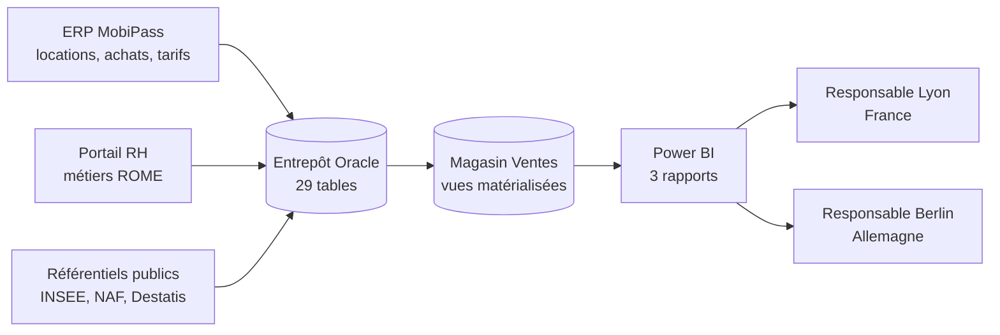
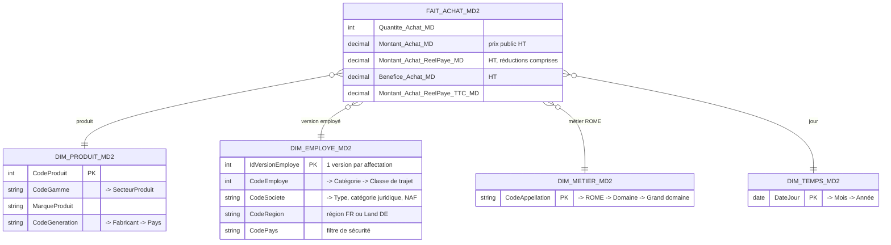
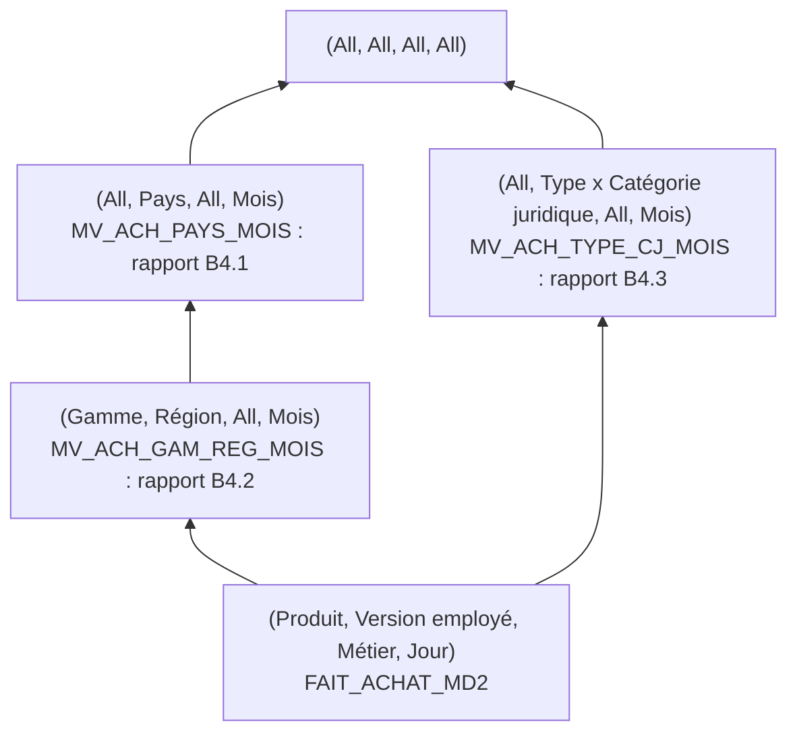

# MobiPass : entrepôt de données Oracle et pilotage des ventes sous Power BI

Projet de Master 2 MIAGE (Université Toulouse Capitole, cours de systèmes d'aide à la décision), réalisé en équipe de 5 en octobre 2026.

**Ma contribution :** l'entrepôt de données, avec l'équipe, et en propre le **magasin « Ventes »** : recueil des besoins, modèle multidimensionnel, implémentation Oracle et tableaux de bord Power BI.

> **English summary.** Decision-support system for MobiPass, a company that rents and sells bikes to employees of client companies in France and Germany. I built the sales data mart: requirements gathering with the client, star-schema design, Oracle implementation (materialized views, `CREATE DIMENSION`, partial aggregate lattice) and a Power BI report connected live to Oracle, with row-level security per country and a VAT-inclusive/exclusive toggle.

---

## Le contexte

MobiPass propose aux salariés de ses sociétés clientes la location et l'achat de vélos et d'équipements de mobilité à prix réduits. Depuis un an, l'offre s'étend à l'Allemagne. L'entreprise a deux responsables des ventes, l'un à Lyon, l'autre à Berlin, avec les mêmes besoins, mais chacun ne doit voir que son pays.

Leur demande :
- analyser les achats **par jour, mois et année**, selon les **produits** et les **employés** ;
- suivre les **quantités**, les **montants réellement payés** (réductions comprises) et les **bénéfices** ;
- avoir le **maximum d'informations sur les sociétés** : catégorie juridique, type, géographie ;
- identifier **les gammes de produits les plus adaptées à chaque lieu** ;
- disposer d'**au moins deux rapports emblématiques**.

## Ce que j'ai livré

| Étape | Résultat |
|---|---|
| Besoins | 3 besoins d'analyse et 3 rapports, validés lors de deux entretiens client ([docs/01_besoins.md](docs/01_besoins.md)) |
| Entrepôt (équipe) | 29 tables Oracle, contraintes métier, jeu de données réaliste et reproductible : 2 ans d'historique, 20 sociétés FR / DE, 400 salariés, 2 200 achats |
| Magasin Ventes | Schéma en étoile : 1 fait, 4 dimensions, 12 hiérarchies, et un treillis partiel de 3 agrégats sous Oracle 11g |
| Restitution | Rapport Power BI de 3 pages connecté en direct à Oracle, avec sécurité par pays et choix HT / TTC |

## Architecture



## Le modèle du magasin Ventes



Le schéma conceptuel complet (paramètres, hiérarchies, cardinalités) est dans [modelisation/MD2_Ventes_schema_conceptuel.json](modelisation/MD2_Ventes_schema_conceptuel.json). Il s'ouvre dans l'éditeur de modèles OLAP [appmodelisationolap](https://crussiere.github.io/appmodelisationolap/) (bouton « Importer (JSON) »).

### Treillis partiel des agrégats

Seuls les agrégats utiles aux rapports mensuels sont matérialisés. Chaque agrégat garde le pays, pour que la sécurité par pays s'applique aussi.



## Les rapports Power BI

| Page | Question à laquelle elle répond | Visuels |
|---|---|---|
| **B4.1 Tableau de bord** | Comment évoluent mes ventes par rapport à l'an dernier ? | Quantité, montant payé, bénéfice ; montant payé mois par mois, années comparées |
| **B4.2 Gammes par territoire** | Quelles gammes vendre dans chaque région / Land ? | Classement des régions ; gammes les plus vendues par région |
| **B4.3 Sociétés** | Quels types de sociétés achètent le plus ? | Montant payé par type de société et catégorie juridique |

Le fichier est dans [powerbi/MD2_Ventes.pbix](powerbi/MD2_Ventes.pbix), et l'export des pages dans [powerbi/MD2_Ventes_rapports.pdf](powerbi/MD2_Ventes_rapports.pdf).

**Deux vues décideurs, un seul rapport.** Les rôles de sécurité *Lyon* (`CodePays = "FR"`) et *Berlin* (`CodePays = "DE"`) filtrent toutes les pages. Sans rôle, on obtient la vue consolidée des deux pays.

**HT ou TTC au choix.** Les tarifs français sont en TTC et les allemands en HT. Tous les montants sont ramenés en **HT** pour pouvoir comparer les pays. Un bouton **HT / TTC** permet au décideur d'afficher le TTC, comme le client l'a demandé en entretien. Le bénéfice reste toujours en HT.

## Points techniques que je retiens

- **Historiser l'employé (dimension à évolution lente de type 2).** Un salarié qui change de service garde ses anciens achats rattachés à son ancien service : une version par affectation, et un achat est relié à la version valable à sa date.
- **Une géographie FR / DE unifiée.** Régions françaises et Länder allemands sont réunis sur un même niveau (NUTS 1), avec des hiérarchies incomplètes : le *Regierungsbezirk* n'existe pas dans tous les Länder (`SKIP WHEN NULL`, jointures externes `(+)`).
- **Contrôler avant de restituer.** Après chaque chargement, une requête vérifie que les 2 730 articles achetés dans l'entrepôt se retrouvent tous dans le magasin (tarif, réduction et version d'employé trouvés pour chaque achat).
- **Coller au besoin.** Après validation avec l'équipe, j'ai retiré du magasin ce que le client n'avait pas demandé (trimestre, tranches d'âge, regroupements de produits inventés).

Le détail des décisions est dans [docs/02_choix_de_conception.md](docs/02_choix_de_conception.md).

## Rejouer le projet

Voir [docs/03_guide_execution.md](docs/03_guide_execution.md) : ordre des scripts sous Oracle, régénération des données et connexion de Power BI.

```
sql/                  01 création ED, 02 contraintes, 03 données, 04 magasin Ventes
generation/           générateur Python du jeu de données (graine fixe, reproductible)
modelisation/         schéma conceptuel du magasin (JSON) et treillis des agrégats (draw.io)
powerbi/              rapport Power BI (.pbix) et export PDF
docs/                 besoins, choix de conception, guide d'exécution
```

## Stack

Oracle 11g (SQL, vues matérialisées, `CREATE DIMENSION`), SQL Developer, Python, Power BI Desktop (DAX, sécurité au niveau des lignes), draw.io, Looping.

*Les données sont fictives, générées pour le projet. Le sujet et les documents de cours appartiennent à l'Université Toulouse Capitole et ne sont pas reproduits ici.*
